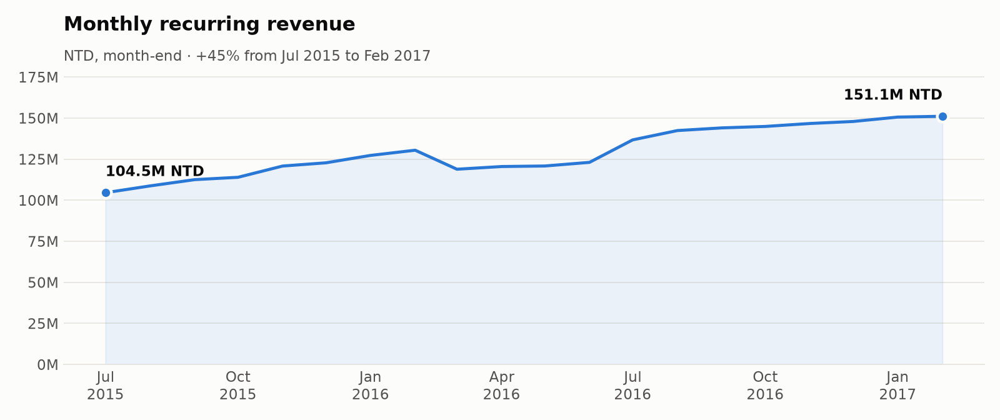
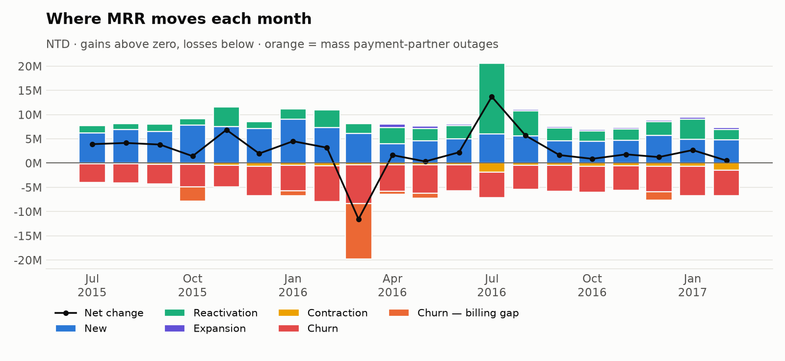
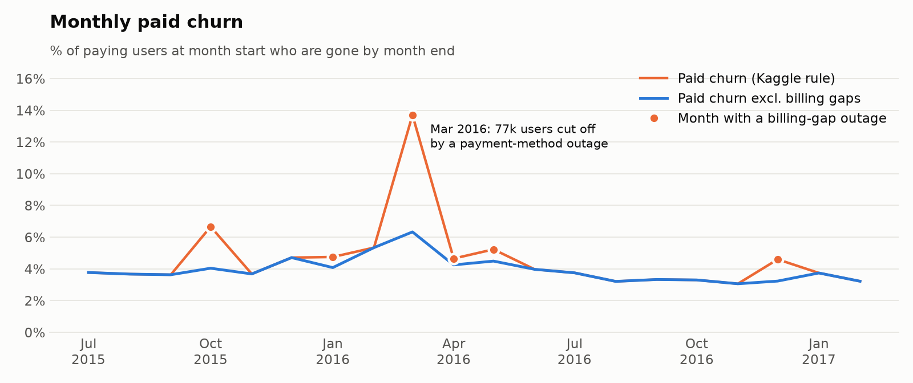
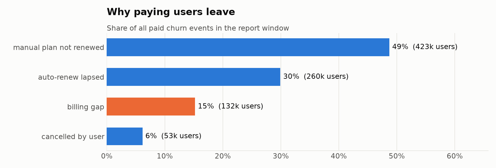
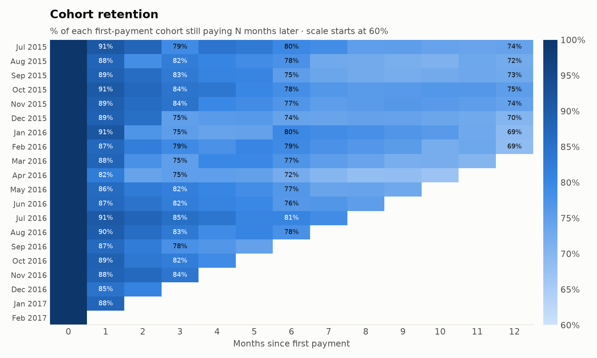
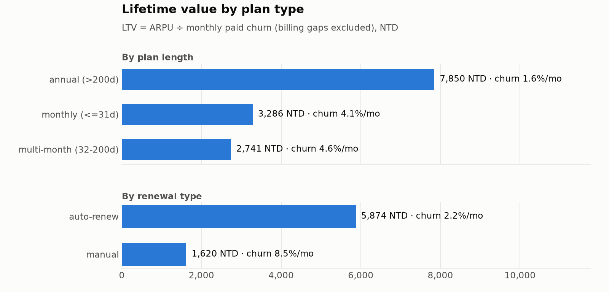
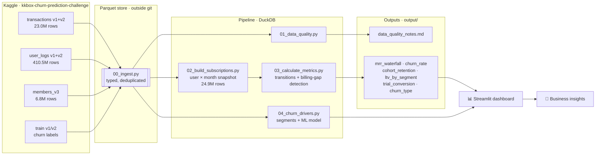
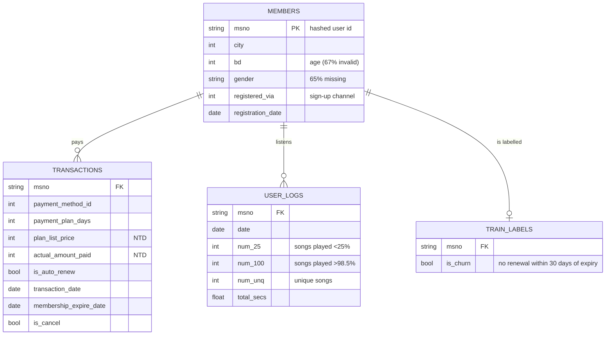

<div align="center">

# KKBox Subscription Analytics

**MRR · Churn · NRR · Cohorts · LTV, rebuilt from 430M rows of raw billing and listening logs**


<br>



</div>

---

## At a glance

KKBox is Taiwan's largest music-streaming subscription service. This project
treats its public Kaggle data the way a Business Analyst would treat a real
billing export: **no metric is pre-computed** — MRR, churn and retention are
reconstructed from 23M payment transactions, then explained with 410M daily
listening logs.

<table>
<tr>
<td align="center"><b>151.1M NTD</b><br><sub>MRR, Feb 2017</sub></td>
<td align="center"><b>+44.5%</b><br><sub>MRR growth, Jul 2015 → Feb 2017</sub></td>
<td align="center"><b>1.17M</b><br><sub>paying users, Feb 2017</sub></td>
<td align="center"><b>3.9%</b><br><sub>avg. monthly paid churn<br>(excl. billing gaps)</sub></td>
<td align="center"><b>94.8%</b><br><sub>avg. monthly NRR</sub></td>
<td align="center"><b>13.1%</b><br><sub>trial → paid conversion</sub></td>
</tr>
</table>

> **Headline:** revenue grows, but the existing base shrinks ~5% a month.
> Growth depends on new sign-ups **and on win-backs** (reactivations added
> 63.7M NTD of MRR over 20 months — more than half of what new users added).
> 15% of all paid churn is not users leaving at all: it is **payment-partner
> outages** where one billing channel fails and its users come back weeks later.

---

## Table of contents

- [Business questions](#business-questions)
- [Key findings](#key-findings)
- [Architecture](#architecture)
- [Data](#data)
- [Metric definitions](#metric-definitions)
- [Analysis decisions](#analysis-decisions)
- [Repository structure](#repository-structure)
- [Getting started](#getting-started)
- [Project tracking](#project-tracking)
- [Limitations](#limitations)

---

## Business questions

| # | Question | Answered by |
|---|---|---|
| 1 | **Health** — is MRR growing in a healthy way, and where does revenue leak? | MRR bridge, churn split, NRR |
| 2 | **Segments** — which sign-up channel, payment method and plan type keep users longest and are worth most? | Cohorts, LTV by segment |
| 3 | **Action** — should KKBox push auto-renew, fight voluntary cancellation, or re-engage low-listening users first? | Churn reasons, churn model *(phase 4)* |

---

## Key findings

### 1 · Where MRR moves each month



Over Jul 2015 – Feb 2017, MRR grew from **104.5M to 151.1M NTD**:

| Movement (20 months) | MRR (NTD) |
|---|---:|
| ➕ New paying users | +118.8M |
| ➕ Reactivated users | +63.7M |
| ➕ Expansion (higher-priced plan) | +5.0M |
| ➖ Contraction (cheaper plan / free promo) | −11.3M |
| ➖ Churn — billing gaps | −18.6M |
| ➖ Churn — all other | −107.1M |

Expansion is almost absent: KKBox has one main price point, so revenue per
user cannot grow — retention is the only lever on the existing base.

### 2 · Paid churn, with and without payment-partner outages



The pipeline detects **7 mass outages** automatically (a payment method's churn
≥ 3× its normal level, ≥ 5,000 users, and most of them return on the same method
within 6 months). The largest — **payment method 39 in Mar 2016** — took
**71,108 paying users** offline (61× its usual monthly churn); **97.5%** came
back. Under the Kaggle definition these are churn; operationally they are a
**payment-partner risk** that churn-reduction campaigns cannot fix.

### 3 · Why paying users leave



Only **6%** of paid churn is an explicit cancellation. Nearly half is users on
**manual (non-auto-renew) plans who simply do not pay again**, and another 30%
is auto-renew payments that lapse. Both are fixable in the billing flow,
not in the product.

### 4 · Cohort retention



Retention is front-loaded and then flattens: **~12% of a new paying cohort is
gone after one month**, ~22% by month 6, and **69–75% are still paying after a
year**. Once users survive the first quarter they are remarkably sticky, so
the cheapest retention win is in the first 1–3 months. Some cells rise from
month 3 to month 6 — that is users coming back (reactivation), not a data error.

### 5 · Lifetime value by plan type



Revenue per user is almost flat (~120–150 NTD/month), so **LTV is decided by
churn**. Auto-renew users are worth **3.6×** manual payers (5,874 vs 1,620 NTD;
2.2% vs 8.5% monthly churn), and annual plans **2.4×** monthly plans. Sign-up
channel matters as much: users registered via channel 7 have an LTV of
6,584 NTD, 4.5× channel 4 (1,467 NTD).

**So what:** moving manual payers onto auto-renew is the single largest LTV
lever in the data — larger than any segment difference driven by price.

> Full numbers: [`output/`](output/) · Trial cohorts: [`output/trial_conversion.csv`](output/trial_conversion.csv)

---

## Architecture



**Why DuckDB + Parquet:** the raw CSVs are ~32 GB, far beyond what pandas can
hold in 16 GB of RAM. DuckDB streams them into compressed Parquet once (8.2 GB,
~4× smaller), then every step runs SQL over Parquet with a capped memory budget
and spills to disk when needed. Only small aggregated CSVs land in the repo.

---

## Data

Source: [KKBox Churn Prediction Challenge](https://www.kaggle.com/competitions/kkbox-churn-prediction-challenge) (WSDM Cup 2018).



| Table | Rows | Period |
|---|---:|---|
| `transactions` (v1 + v2, deduplicated) | 22,975,416 | Jan 2015 – Mar 2017 |
| `user_logs` (v1 + v2) | 410,502,905 | Jan 2015 – Mar 2017 |
| `members_v3` | 6,769,473 | — |
| `train_v2` labels | 970,960 | Mar 2017 expiries |

Every data issue found, and how it is handled, is in
[`output/data_quality_notes.md`](output/data_quality_notes.md).

---

## Metric definitions

All money is **NTD**. A user's state at a month-end comes from their latest
transaction on or before that date.

| Metric | Definition |
|---|---|
| **Active** | month-end falls inside a paid or free membership (30-day grace for late renewals) |
| **MRR** | `actual_amount_paid ÷ plan months`; 28–31-day plans = 1 month, longer plans = days ÷ 30 |
| **Logo churn** | active at M−1, not active at M (Kaggle rule) |
| **Paid churn** | paying at M−1, not active at M |
| **Paid churn excl. billing gap** | paid churn without users caught in a detected payment-partner outage |
| **Revenue churn** | MRR of paid churners ÷ MRR at M−1 |
| **NRR** | MRR at M from users paying at M−1 ÷ their MRR at M−1 |
| **Trial conversion** | users whose first month is free and who pay within 3 months |
| **LTV** | ARPU ÷ monthly paid churn (billing gaps excluded) |

```text
NRR  = (Starting MRR + Expansion − Contraction − Churn) / Starting MRR
LTV  = ARPU / monthly paid churn
```

---

## Analysis decisions

Decisions that change the numbers, and why ([KKBOX-5](https://baohandao2303.atlassian.net/browse/KKBOX-5)):

| Decision | Choice | Reason |
|---|---|---|
| Churn definition | Kaggle's: no renewal within 30 days of expiry | Metrics and ML labels agree |
| Billing-gap outages | Kept in churn, **flagged**, also reported excluded | Kaggle-consistent, but separates a partner risk from real churn |
| Free trials | Tracked as conversion, never mixed into paid churn | A trial ending is not a paying user leaving |
| Report window | **Jul 2015 – Feb 2017** | No data before Jan 2015 (6-month warm-up); Mar 2017 lacks the 30-day look-ahead |
| `user_logs` dedup | v1 and v2 unioned as-is | Date ranges cannot overlap; a DISTINCT over 410M rows needs > 10 GB RAM |

---

## Repository structure

```text
taskflow-saas-metrics/
├── README.md
├── requirements.txt
├── scripts/
│   ├── config.py                  paths, report window, DuckDB connection helper
│   ├── 00_ingest.py               Kaggle CSV → typed Parquet (raw data stays outside git)
│   ├── 01_data_quality.py         checks + handling decisions → data_quality_notes.md
│   ├── 02_build_subscriptions.py  user × month snapshot (MRR, status, cohort)
│   ├── 03_calculate_metrics.py    MRR bridge, churn, NRR, cohorts, LTV, billing gaps
│   └── make_readme_charts.py      renders docs/images/*.png from output/
├── output/                        small aggregated results — all generated
│   ├── data_quality_notes.md
│   ├── monthly_summary.csv
│   ├── mrr_waterfall.csv
│   ├── churn_rate_by_month.csv
│   ├── churn_type_by_month.csv
│   ├── billing_gap_episodes.csv
│   ├── trial_conversion.csv
│   ├── cohort_retention.csv
│   └── ltv_by_segment.csv
├── docs/images/                   README charts
└── dashboard/
    └── app.py                     Streamlit app (being rebuilt — phase 5)
```

---

## Getting started

**Requirements:** Python 3.10+, ~50 GB free disk, 16 GB RAM, a
[Kaggle API token](https://www.kaggle.com/docs/api) and acceptance of the
competition rules.

```bash
# 1. Install
pip install -r requirements.txt

# 2. Download + extract the data (outside the repo)
kaggle competitions download -c kkbox-churn-prediction-challenge -p D:/datasets/kkbox/raw
7z x "D:/datasets/kkbox/raw/*.7z" -oD:/datasets/kkbox/csv

# 3. Point the pipeline at it (default: D:\datasets\kkbox)
export KKBOX_DIR=D:/datasets/kkbox          # optional
export KKBOX_MEMORY=10GB                    # optional DuckDB RAM cap

# 4. Run the pipeline
python scripts/00_ingest.py                 # ~15 min, CSV → Parquet
python scripts/01_data_quality.py
python scripts/02_build_subscriptions.py    # ~3 min
python scripts/03_calculate_metrics.py      # ~4 min with 10 GB RAM, cached after
python scripts/make_readme_charts.py
```

---

## Project tracking

Work is tracked in Jira project **[KKBOX](https://baohandao2303.atlassian.net/jira/software/projects/KKBOX/boards)**.

| Phase | Jira | Status |
|---|---|:---:|
| 0 · Ingest to Parquet | [KKBOX-2](https://baohandao2303.atlassian.net/browse/KKBOX-2) | ✅ |
| 1 · Data quality | [KKBOX-3](https://baohandao2303.atlassian.net/browse/KKBOX-3) | ✅ |
| 2 · Subscription snapshot | [KKBOX-4](https://baohandao2303.atlassian.net/browse/KKBOX-4) | ✅ |
| — · Analysis decisions | [KKBOX-5](https://baohandao2303.atlassian.net/browse/KKBOX-5) | ✅ |
| 3 · SaaS metrics | [KKBOX-6](https://baohandao2303.atlassian.net/browse/KKBOX-6) | ✅ |
| 4 · Churn drivers + ML model | [KKBOX-7](https://baohandao2303.atlassian.net/browse/KKBOX-7) | ⏳ |
| 5 · Dashboard | [KKBOX-8](https://baohandao2303.atlassian.net/browse/KKBOX-8) | ⏳ |
| 6 · Insights write-up | [KKBOX-9](https://baohandao2303.atlassian.net/browse/KKBOX-9) | ⏳ |

---

## Limitations

- **No acquisition cost data** — CAC and LTV:CAC cannot be computed; LTV is compared across segments instead.
- **Left-censored start** — users on long plans bought before 2015 are invisible until they renew, hence the Jul 2015 report start.
- **Single price point** — expansion revenue is structurally near zero, so NRR mostly measures churn.
- **Member attributes are sparse** — age is invalid for 67% of members and gender missing for 65%; 18% of paying users have no member record.
- **Payment method IDs are anonymised** — outages can be located by method, not attributed to a named partner.

<div align="center">
<sub>Data © KKBox, released for the WSDM Cup 2018 Kaggle competition. Analysis by <a href="https://github.com/handao2303">Han Dao</a>.</sub>
</div>
